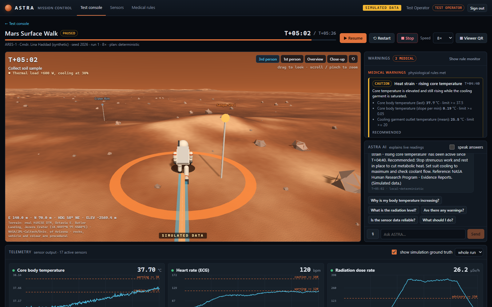
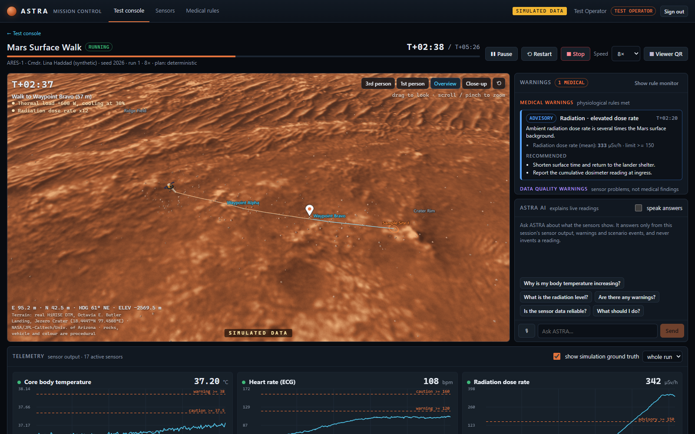
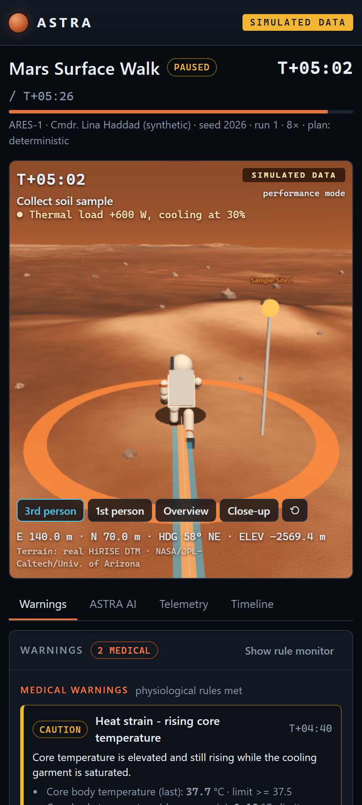
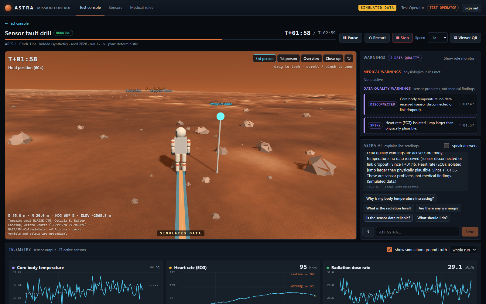

# ASTRA — Astronaut Health Monitoring & Mars Mission Simulation

ASTRA is a working, integrated demonstration platform: a deterministic simulation
of an astronaut's Mars surface walk, synthetic sensor pipelines, a medical rule
engine, role-based mission-control dashboards, a live 3D scene on **real Jezero
Crater topography**, and a context-aware AI assistant with voice.

> **All data in ASTRA is simulated.** Astronaut profiles are synthetic, the
> physiology models are engineering approximations, and medical rule thresholds
> are demonstration values. ASTRA is not a medical device.



| Overview camera on the HiRISE terrain | Instrument Viewer on a phone (QR access) |
|---|---|
|  |  |

## Quick start

Requirements: **Python 3.11+** and **Node.js 20+**. No database server, Docker,
internet connection or API key is needed.

**Windows (PowerShell)**

```powershell
powershell -ExecutionPolicy Bypass -File scripts\start.ps1
```

The first run creates `backend\.venv`, installs dependencies and builds the UI,
then serves everything on <http://localhost:8000>. Windows may ask once to allow
Python through the firewall; allow it on private networks so phones can open QR
links.

**macOS / Linux**

```bash
python3 -m venv backend/.venv && backend/.venv/bin/pip install -r backend/requirements.txt
(cd frontend && npm install && npm run build)
(cd backend && .venv/bin/uvicorn app.main:app --host 0.0.0.0 --port 8000)
```

### Demo accounts

Seeded into an empty database. The login page offers one-click sign-in for them.

| Role | Username | Password | What it can do |
|---|---|---|---|
| Admin | `admin` | `astra-admin-2026` | Users and roles, configuration, audit log, global review, emergency stop |
| Physical Team | `physical` | `astra-physical-2026` | Sensors, custom fields, simulation profiles, failure signatures |
| Medical Team | `medical` | `astra-medical-2026` | Conditions, warning rules, recommendations, sources, datasets, astronaut profiles |
| Test Operator | `operator` | `astra-operator-2026` | Natural-language tests, plan review, playback control, QR codes, ASTRA AI |
| Instrument Viewer | `viewer` | `astra-viewer-2026` | Watch sessions read-only |

These are demonstration credentials. Change them (Admin → Users) or set
`ASTRA_DEMO_PASSWORD` before exposing ASTRA beyond a demo network. There is no
self-registration: only an admin can create accounts.

## Five-minute demo script

1. Sign in as **Test Operator**. The default scenario text is already loaded:
   *"Simulate an astronaut exiting the lander, walking along a defined route… "*
2. **Generate plan.** The prompt becomes a strict, validated plan. Review the
   steps, the interpretation notes and the route drawn on the real orthoimage.
3. **Confirm plan & create session**, then **Start** (playback 4×; change it any time).
4. Watch the astronaut leave the lander, walk the route, kneel and collect a
   sample. Try the four cameras: 3rd person, 1st person, Overview, Close-up.
5. About T+02:20 the **radiation advisory** appears; about T+04:35 the **heat
   strain caution** appears. They are independent: the core-temperature chart is
   unaffected by the radiation event.
6. Ask ASTRA: **"Why is my body temperature increasing?"** (type, click the
   suggestion, or use the microphone; tick *speak answers* to hear the reply).
7. Click **Viewer QR**, generate a code and scan it with a phone on the same
   Wi-Fi. The phone gets a read-only live view; revoke the link to cut it off.
8. Load the **Sensor fault drill** scenario to see data-quality warnings
   (disconnect, spikes) raised *instead of* medical warnings, and a medical rule
   reported as inhibited while its sensor is untrusted (screenshot below).
9. Sign in as **Physical Team**, **Medical Team** and **Admin** to see the
   registries, the rule editor, the audit log and the emergency stop.



## What is real and what is simulated

| | |
|---|---|
| **Real** | Terrain elevations and surface brightness: HiRISE DTM `DTEEC_045994_1985_046060_1985_U01` and orthoimage `ESP_045994_1985`, centred on the Perseverance landing site (18.4447°N, 77.4508°E). |
| **Procedural** | Surface colour, fine grain, rocks, lander, astronaut, markers, sky and lighting. |
| **Simulated** | Every sensor value, the physiology, suit and environment models, radiation and thermal events, and all astronaut profiles. |

Details and attributions: [docs/DATA_PROVENANCE.md](docs/DATA_PROVENANCE.md).

## How it works (short version)

Three strictly separated layers run every half second of simulated time:

1. **Simulation ground truth** — physiology, suit and environment models driven
   by the plan and a random seed.
2. **Sensor output** — ground truth plus each sensor's noise, drift, spikes,
   stuck values, disconnections and injected faults.
3. **Analytical output** — data-quality assessment first, then medical rules
   evaluated on trusted readings only.

Data-quality warnings (about sensors) and medical warnings (about the astronaut)
are different objects with different colours and wording throughout the UI. The
same seed and plan always reproduce the same run, bit for bit.

Full description: [docs/ARCHITECTURE.md](docs/ARCHITECTURE.md).

## Configuration

Everything is optional. Copy [.env.example](.env.example) to `.env` to change it.

| Setting | Default | Purpose |
|---|---|---|
| `ASTRA_DATABASE_URL` | SQLite file in `backend/data/` | Use `postgresql+psycopg://…` for PostgreSQL |
| `ASTRA_SECRET_KEY` | generated once | Signs login tokens |
| `ASTRA_PUBLIC_BASE_URL` | auto-detected LAN address | Address encoded in QR codes |
| `ASTRA_LLM_PROVIDER` | `local` | `local`, `anthropic` or `openai_compatible` |
| `ASTRA_SPEECH_PROVIDER` | `browser` | `browser` or `openai_compatible` |

Runtime settings (QR lifetime, default speed, AI mode, simulation lock) are edited
by the Admin under **Administration → Configuration**.

### ASTRA AI and voice providers

ASTRA is provider-agnostic and offline-first:

- **`local` (default):** a deterministic planner converts prompts to plans and a
  deterministic explainer answers questions from live session context. No network.
- **`anthropic`:** Claude through the official SDK (default model
  `claude-opus-5-5`, low effort for fast replies, server-side refusal fallback
  enabled). Set `ANTHROPIC_API_KEY`.
- **`openai_compatible`:** any server with the OpenAI chat-completions API, for
  example a local Ollama or LM Studio instance.

Whatever the provider, an LLM plan is only *data*: it must pass the strict plan
schema and the world/sensor checks, otherwise it is discarded and the
deterministic planner is used. If a provider is missing, slow or fails during
chat, the local explainer answers and the UI says so.

Voice uses the browser's Web Speech API by default (speech synthesis works
offline; browser speech *recognition* needs a network connection in Chrome and
Edge, so typed chat is always available). A server-side speech provider can be
configured instead.

## Tests

```powershell
powershell -ExecutionPolicy Bypass -File scripts\test.ps1          # backend + type-check
powershell -ExecutionPolicy Bypass -File scripts\test.ps1 -E2E     # also drives the real UI (ASTRA must be running)
```

- `backend/tests/test_engine.py` — determinism, radiation/thermal independence,
  layer separation, each fault type, rule inhibition, plan validation.
- `backend/tests/test_planner_assistant.py` — prompt interpretation, LLM
  fallback, rejection of malicious plan output, assistant answers.
- `backend/tests/test_api.py` — login, RBAC matrix, sensor lifecycle, medical
  CRUD and imports, full session flow over WebSocket, QR tokens, emergency stop.
- `frontend/e2e/smoke.mjs` — a real browser runs the whole demo scenario.

### Verification status

| Verified on the development machine | Not verified |
|---|---|
| 75 backend tests pass on SQLite **and** on PostgreSQL 16 | The Docker image and `docker compose` were written but not built (Docker was not installed) |
| Browser end-to-end test passes in Chrome (desktop and emulated phone) | A physical phone scanning the QR code |
| 3D scene renders with software WebGL, including the automatic performance mode | Frame rate on real GPU hardware |
| Local planner, local explainer and LLM-failure fallback | Live calls to Anthropic or an OpenAI-compatible server (no credentials were available) |
| | Server-side speech provider; browser microphone input |

## Docker

```bash
cp .env.example .env      # set POSTGRES_PASSWORD, ASTRA_SECRET_KEY and ASTRA_PUBLIC_BASE_URL
docker compose up --build
```

This starts PostgreSQL 16 and one ASTRA container serving API and UI on port 8000.

## Project layout

```
backend/
  astra_sim/            deterministic simulation engine (no web or database imports)
  app/                  FastAPI application
    api/                routes: auth, admin, physical, medical, mission (+ WebSocket)
    services/           registry snapshot, planner, assistant, LLM, voice, runtime
    models.py           relational schema          seed_data.py   demo catalogue
  assets/terrain/       processed real terrain + provenance.json
  tests/                pytest suite
frontend/
  src/mission/          3D scene, live store, charts, panels, chat
  src/pages/            one page per role
  e2e/smoke.mjs         browser end-to-end test
tools/terrain/          rebuilds terrain assets from the HiRISE products
scripts/                setup / start / dev / test, headless scenario runner
docs/                   architecture and data provenance
```

Useful extras:

- `backend/.venv/Scripts/python scripts/run_headless.py "your prompt"` runs a
  scenario without the UI and prints the timeline, events and key values.
- `python -I tools/terrain/build_terrain.py --raw-dir data/raw/hirise_dtm_045994 --out-dir backend/assets/terrain`
  rebuilds the terrain (needs `numpy` and `pillow`, downloads about 125 MB).
- API documentation is served at `/api/docs` while ASTRA is running.

## Assumptions and limitations

- The mission starts already landed; there is no launch or landing sequence.
- Waypoints and the lander pose are seeded and shown read-only; there is no
  waypoint editor yet.
- Schema changes are applied with `create_all` on start-up; there are no
  migrations, so a schema change during development means a fresh database.
- A running simulation lives in server memory. After a server restart it is
  marked stopped and can be replayed identically with **Restart**.
- Only the latest run's telemetry frames are stored per session; events and
  warnings of earlier runs are kept.
- The login token is passed as a query parameter when opening the WebSocket
  (browsers cannot set headers there); use HTTPS in any real deployment.
- A calibration bias cannot be detected by single-sensor checks. This is the
  gap the `DataQualityAssessor` interface is designed for a future ML trust
  layer to fill.
