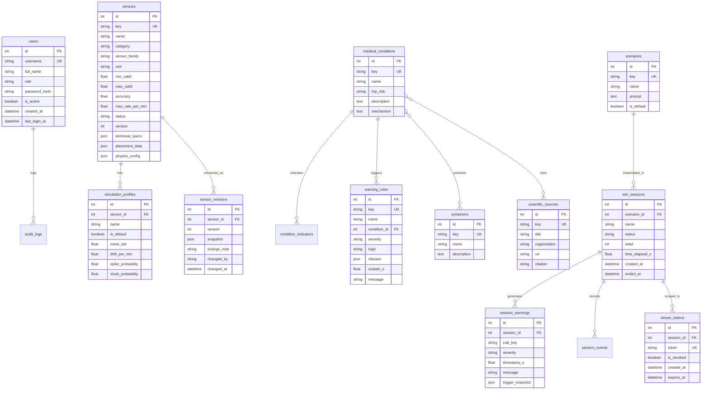

# ASTRA — Database Design & Schema Specification
**Database Engines Supported**: SQLite (default, embedded local storage) / PostgreSQL 16 (production container)  
**ORM Framework**: SQLAlchemy 2.0 (Declarative Mapped Models)  
**Schema Version**: 1.0.0-Release  
**Author**: Gravity Brains / ASTRA Pioneers Data Engineering Team  

---

## 1. Overview & Persistence Strategy

ASTRA utilizes a hybrid persistence architecture engineered for zero-configuration, fully offline operation out of the box, with seamless scaling to PostgreSQL for enterprise containerized deployments.

- **Local Development & Offline Flight Mode**: By default, `ASTRA_DATABASE_URL` is empty, causing the application to automatically initialize an embedded SQLite database at `backend/data/astra.db`.
- **Containerized / Multi-User Mode**: In Docker deployments, `ASTRA_DATABASE_URL` points to a PostgreSQL 16 Alpine container with high-performance connection pooling via `psycopg[binary]`.
- **Timestamp Normalization**: All timestamps are stored as timezone-naive UTC (`DateTime`), ensuring identical querying and sorting semantics across SQLite and PostgreSQL.
- **JSON Support**: Semi-structured configurations, placement coordinates, failure parameters, and audit details are stored in native SQLAlchemy `JSON` columns.

---

## 2. Entity-Relationship (ER) Diagram

---

## 3. Data Dictionary by Functional Domain

### 3.1 Platform Domain (`users`, `audit_logs`, `system_config`)

#### Table: `users`
Stores authenticated user accounts with roles for RBAC.
| Field | Type | Constraints | Description |
|---|---|---|---|
| `id` | `Integer` | Primary Key | Auto-incrementing identifier |
| `username` | `String(60)` | Unique, Indexed, Non-Null | Unique sign-in handle (e.g. `admin`) |
| `full_name` | `String(120)` | Default `""` | User's full name |
| `role` | `String(20)` | Indexed, Non-Null | One of: `admin`, `physical`, `medical`, `operator`, `viewer` |
| `password_hash` | `String(255)` | Non-Null | scrypt password hash (`scrypt$N$r$p$salt$hash`) |
| `is_active` | `Boolean` | Default `True` | Account active flag |
| `created_at` | `DateTime` | Non-Null | UTC creation timestamp |
| `last_login_at` | `DateTime` | Nullable | UTC timestamp of last successful authentication |

#### Table: `audit_logs`
Immutable record of all security-sensitive and operational actions.
| Field | Type | Constraints | Description |
|---|---|---|---|
| `id` | `Integer` | Primary Key | Auto-incrementing identifier |
| `ts` | `DateTime` | Indexed, Non-Null | UTC timestamp of event |
| `user_id` | `Integer` | Nullable | ID of user performing the action |
| `username` | `String(60)` | Default `"system"` | Username of actor |
| `role` | `String(20)` | Default `"system"` | Role of actor |
| `action` | `String(60)` | Indexed, Non-Null | Action identifier (e.g. `user.create`, `stop.engage`) |
| `entity_type` | `String(60)` | Default `""` | Entity type affected (`sensor`, `rule`, `session`) |
| `entity_id` | `String(80)` | Default `""` | Key or ID of entity affected |
| `detail` | `JSON` | Default `{}` | Structured contextual metadata |

---

### 3.2 Physical Domain (`sensors`, `sensor_versions`, `simulation_profiles`, `failure_signatures`, `custom_field_defs`)

#### Table: `sensors`
Core spaceflight transducer and telemetry channel definitions.
| Field | Type | Constraints | Description |
|---|---|---|---|
| `id` | `Integer` | Primary Key | Auto-incrementing identifier |
| `key` | `String(60)` | Unique, Indexed | Machine telemetry key (e.g. `spo2_pct`) |
| `name` | `String(120)` | Non-Null | Human-readable name |
| `category` | `String(40)` | Indexed | `physiological`, `spacesuit`, or `environmental` |
| `sensor_family` | `String(60)` | Default `"generic"` | Transducer family (e.g. `rtd_pt100`, `optical_ppg`) |
| `unit` | `String(30)` | Non-Null | Measurement unit (`%`, `bpm`, `°C`, `kPa`, `μSv/h`) |
| `min_valid` | `Float` | Non-Null | Physical lower validity bound |
| `max_valid` | `Float` | Non-Null | Physical upper validity bound |
| `accuracy` | `Float` | Default `0.0` | Transducer rated accuracy (± unit) |
| `max_rate_per_min` | `Float` | Default `0.0` | Maximum physiological slew rate per minute |
| `status` | `String(20)` | Indexed | `draft`, `active`, or `archived` |
| `version` | `Integer` | Default `1` | Monotonically increasing version number |
| `technical_specs` | `JSON` | Default `{}` | Metrological and electrical parameters |
| `placement_data` | `JSON` | Default `{}` | 3D spacesuit anatomical coordinates $(x, y, z)$ |
| `physics_config` | `JSON` | Default `{}` | Transducer equations & coefficients |

#### Table: `sensor_versions`
Historical snapshot archive providing immutable auditability for sensor calibrations.
| Field | Type | Constraints | Description |
|---|---|---|---|
| `id` | `Integer` | Primary Key | Auto-incrementing identifier |
| `sensor_id` | `Integer` | FK (`sensors.id`, CASCADE) | Parent sensor foreign key |
| `version` | `Integer` | Non-Null | Snapshot version number |
| `snapshot` | `JSON` | Non-Null | Complete serialized sensor dictionary at time of commit |
| `change_note` | `String(300)` | Default `""` | Engineer's change rationale |
| `changed_by` | `String(60)` | Default `"system"` | Engineer username |
| `changed_at` | `DateTime` | Non-Null | UTC timestamp of version commit |

---

### 3.3 Medical Domain (`medical_conditions`, `warning_rules`, `scientific_sources`, `astronaut_profiles`)

#### Table: `medical_conditions`
Spaceflight medical conditions referenced in NASA-STD-3001.
| Field | Type | Constraints | Description |
|---|---|---|---|
| `id` | `Integer` | Primary Key | Auto-incrementing identifier |
| `key` | `String(60)` | Unique, Indexed | Unique code (e.g. `hypoxia`, `heat_exhaustion`) |
| `name` | `String(120)` | Non-Null | Full medical diagnostic title |
| `hrp_risk` | `String(120)` | Default `""` | NASA Human Research Roadmap gap code |
| `description` | `Text` | Non-Null | Clinical presentation overview |
| `mechanism` | `Text` | Non-Null | Aerospace pathophysiological mechanism |

#### Table: `warning_rules`
Deterministic threshold and trend warning triggers.
| Field | Type | Constraints | Description |
|---|---|---|---|
| `id` | `Integer` | Primary Key | Auto-incrementing identifier |
| `key` | `String(60)` | Unique, Indexed | Rule identifier (e.g. `CRIT-HYPOXIA-001`) |
| `name` | `String(120)` | Non-Null | Human-readable rule title |
| `condition_id` | `Integer` | FK (`medical_conditions.id`) | Associated clinical condition |
| `severity` | `String(20)` | Non-Null | `advisory`, `caution`, `warning`, `critical` |
| `logic` | `String(10)` | Default `"all"` | Clause evaluation logic (`all` / `any`) |
| `clauses` | `JSON` | Non-Null | Array of conditional expressions (`[{sensor, op, value}]`) |
| `sustain_s` | `Float` | Default `0.0` | Minimum duration condition must persist before trigger |
| `message` | `String(300)` | Non-Null | Flight surgeon alert notification text |

---

### 3.4 Mission & Telemetry Domain (`scenarios`, `sim_sessions`, `session_warnings`, `viewer_tokens`)

#### Table: `sim_sessions`
Live or archived mission simulation sessions.
| Field | Type | Constraints | Description |
|---|---|---|---|
| `id` | `Integer` | Primary Key | Auto-incrementing identifier |
| `scenario_id` | `Integer` | FK (`scenarios.id`) | Scenario blueprint identifier |
| `name` | `String(120)` | Non-Null | Session title |
| `status` | `String(20)` | Indexed | `planned`, `running`, `paused`, `completed`, `aborted` |
| `seed` | `Integer` | Non-Null | Pseudo-random generator seed for bit-identical replay |
| `time_elapsed_s`| `Float` | Default `0.0` | Simulation elapsed mission clock (seconds) |
| `created_at` | `DateTime` | Non-Null | UTC creation timestamp |
| `ended_at` | `DateTime` | Nullable | UTC termination timestamp |

#### Table: `viewer_tokens`
Cryptographically secure temporary tokens enabling mobile QR viewer pairing.
| Field | Type | Constraints | Description |
|---|---|---|---|
| `id` | `Integer` | Primary Key | Auto-incrementing identifier |
| `session_id` | `Integer` | FK (`sim_sessions.id`, CASCADE) | Scoped simulation session |
| `token` | `String(64)` | Unique, Indexed | Cryptographic bearer token (`vt_...`) |
| `is_revoked` | `Boolean` | Default `False` | Revocation status |
| `created_at` | `DateTime` | Non-Null | UTC creation timestamp |
| `expires_at` | `DateTime` | Nullable | Expiry timestamp |
