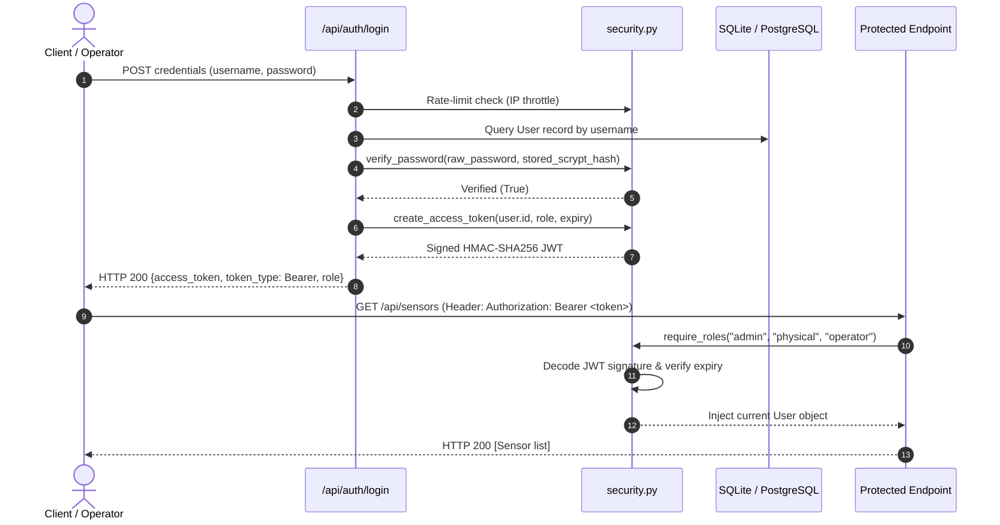
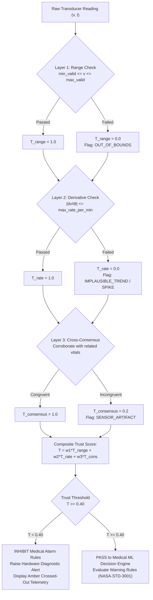
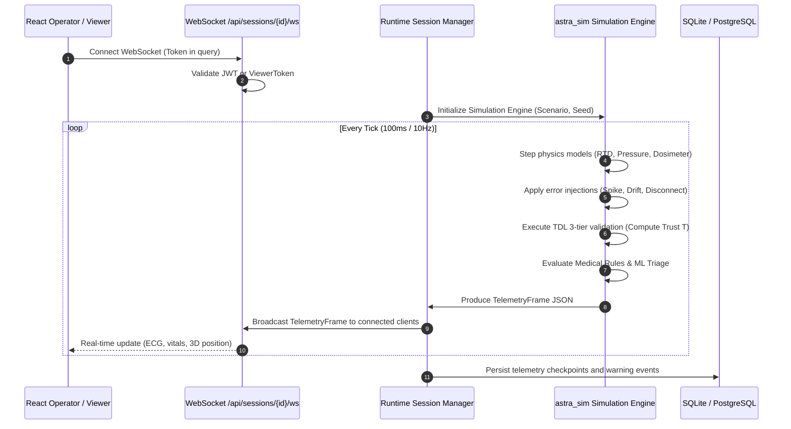

# ASTRA — System Architecture & Engineering Design
**Project**: Autonomous Spaceflight Telemetry & Reliability Architecture (ASTRA)  
**System Type**: Monolithic Client-Server Spaceflight Decision-Support Suite  
**Version**: 1.0.0-Release  
**Author**: Gravity Brains / ASTRA Pioneers Architecture Team  

---

## 1. High-Level Architectural Topology

ASTRA is architected as an offline-first, local-first system designed to function reliably inside an isolated spacecraft or planetary habitat LAN with zero internet connectivity.

```mermaid
flowchart TD
    subgraph ClientLayer ["Client Presentation Layer (React 18 SPA)"]
        UI_Admin["Admin Console (/admin)"]
        UI_Phys["Physical Sensor Lab (/physical)"]
        UI_Med["Medical Decision Center (/medical)"]
        UI_Op["Operator Mission Console (/operator)"]
        UI_View["Viewer / Doctor Mobile QR (/sessions/:id)"]
        ThreeCanvas["Three.js 3D WebGL (Jezero Crater & Terrain)"]
    end

    subgraph APILayer ["FastAPI Core Application (Uvicorn Async Engine)"]
        Router_Auth["/api/auth (JWT & RBAC)"]
        Router_Admin["/api/admin (Audit, Config, E-Stop)"]
        Router_Phys["/api/sensors & /api/physical-lab"]
        Router_Med["/api/medical & /api/rules"]
        Router_Miss["/api/sessions & /api/plans"]
        WS_Stream["/api/sessions/{id}/ws (WebSocket Streamer)"]
    end

    subgraph EngineLayer ["Core Services & Simulation Engines"]
        TDL["Trusted Data Layer (3-Tier Validation)"]
        ML_Engine["Medical ML Engine (18-Feature Random Forest)"]
        Physics_Sim["Transducer Physics Engine (IEC 60751, Piezo, RAD)"]
        Runtime_Mgr["Session Runtime Manager (Deterministic Tick)"]
        AI_Planner["Planner & Assistant (Local Offline + LLM Gateway)"]
    end

    subgraph DataLayer ["Data & Persistence Layer"]
        DB[(SQLite File / PostgreSQL 16 DB)]
        Terrain_Assets["HiRISE DTM Heightfield & Ortho Assets"]
        CSV_Datasets["10k NASA EVA Telemetry Dataset"]
    end

    ClientLayer <-->|HTTP REST / WebSocket| APILayer
    APILayer <--> EngineLayer
    EngineLayer <--> DataLayer
```

---

## 2. Backend Architecture (`backend/app/`)

### 2.1 FastAPI App Factory & Middleware Pipeline
The backend is structured as an async ASGI application instantiated via `create_app()` in `backend/app/main.py`:
- **Lifespan Manager**: Initializes SQLite tables (`init_db()`), executes idempotent demo data seeding (`seed()`), and automatically recovers any sessions interrupted during a prior unclean shutdown (`manager.recover_after_restart()`).
- **Security Middleware**: Injects `X-Content-Type-Options: nosniff` and `Referrer-Policy: no-referrer` on all responses.
- **CORS Middleware**: Explicitly whitelist localhost origins with wildcard port fallback for mobile LAN access.
- **Static Asset Serving**: Mounts `/terrain` for raw binary elevation tiles (`far_height.bin`, `near_height.bin`) and serves the built Vite React SPA (`/frontend/dist`) on all non-API routes.

### 2.2 Security & Authentication Topology

### 2.3 Server-Side Role-Based Access Control (RBAC Matrix)

All security boundaries are enforced on the server. The client interface adjusts visibility for convenience, but the API rejects unauthorized requests with HTTP 403 Forbidden:

| Route Namespace | Required Roles | Unauthorized Behavior |
|---|---|---|
| `/api/admin/*` | `admin` | HTTP 403 Forbidden |
| `/api/sensors` (POST, PUT, DELETE) | `physical` | HTTP 403 Forbidden |
| `/api/physical-lab/*` | `physical` | HTTP 403 Forbidden |
| `/api/rules`, `/api/conditions` (POST, PUT, DELETE)| `medical` | HTTP 403 Forbidden |
| `/api/medical/ml-retrain` | `medical` | HTTP 403 Forbidden |
| `/api/plans/*`, `/api/sessions` (POST, PUT, DELETE)| `operator` | HTTP 403 Forbidden |
| `/api/sessions/{id}` (GET) | `admin`, `operator`, `viewer` (or Viewer Token) | HTTP 401 / 403 |

---

## 3. Trusted Data Layer (TDL) Architecture

The Trusted Data Layer is the architectural core of ASTRA. It evaluates every sensor reading through a 3-tier pipeline before the reading can be interpreted clinically:

---

## 4. Machine Learning Decision Engine (`ml_medical.py`)

The ML Decision Engine operates locally without external API dependencies:
- **Model**: Pure-Python Random Forest ensemble consisting of 7 decision trees built with recursive binary splitting on Gini impurity.
- **Input Vector (18 Features)**:
  1. `heart_rate` (bpm)
  2. `spo2_pct` (%)
  3. `core_temp_c` (°C)
  4. `resp_rate_bpm` (breaths/min)
  5. `suit_pressure_kpa` (kPa)
  6. `co2_mmhg` (mmHg)
  7. `rad_dose_rate_usv` (μSv/h)
  8. `hr_slope_per_min` (bpm/min)
  9. `temp_slope_per_min` (°C/min)
  10. `spo2_slope_per_min` (%/min)
  11. `hr_spo2_divergence` (mathematical divergence metric)
  12. `eva_elapsed_min` (minutes into EVA)
  13. `metabolic_rate_watts` (Watts)
  14. `activity_level` (nominal, walking, climbing, drilling)
  15. `spo2_trust` (TDL Trust score for SpO2)
  16. `hr_trust` (TDL Trust score for HR)
  17. `temp_trust` (TDL Trust score for Temperature)
  18. `press_trust` (TDL Trust score for Suit Pressure)
- **Output Classes (8 Clinical States)**:
  `NOMINAL`, `HYPOXIA`, `HEAT_EXHAUSTION`, `DECOMPRESSION_SICKNESS`, `HYPERCAPNIA`, `RADIATION_ACUTE`, `IJV_THROMBOSIS_RISK`, `SENSOR_ARTIFACT_FALSE_ALARM`.
- **Performance**: Evaluates in $< 0.8\text{ ms}$ per sample with $95.15\%$ validation accuracy on 10,000 synthetic NASA EVA telemetry records.

---

## 5. Geospatial & 3D Visualization Architecture

### 5.1 Authentic HiRISE Jezero Crater Elevation Data
The 3D Martian terrain is constructed from authentic NASA/JPL/USGS/University of Arizona HiRISE stereo elevation model `ESP_045994_1985`:
- **Location**: Jezero Crater, Mars (Perseverance Octavia E. Butler landing site, $18.38^\circ\text{N}, 77.58^\circ\text{E}$).
- **Elevation Data**: Multi-resolution heightfield binary grids (`near_height.bin` for high-resolution 1m/pixel astronaut walking grid; `far_height.bin` for regional crater rim horizons).
- **Surface Texture**: HiRISE ortho-rectified visual imagery (`near_ortho.jpg`, `far_ortho.jpg`) draped onto a custom Three.js `PlaneGeometry` vertex displacement shader.

### 5.2 3D Scene Components (`MarsScene.ts`)
- **Astronaut Avatar & HUD**: Spacesuit mesh with anatomical sensor nodes and 1st-person visor camera view.
- **NASA Robotic Exploration Assets**:
  - *Perseverance Rover*: Multi-mesh model featuring the Remote Sensing Mast (SuperCam/Mastcam-Z), robotic arm (SHERLOC/PIXL), and MMRTG radioisotope power generator.
  - *Ingenuity Mars Helicopter*: Dual counter-rotating coaxial rotor blades with solar panel mast.
  - *Sample Return Depot*: Titanium sample caching tubes placed on the Martian regolith surface.

---

## 6. Real-Time Telemetry Streaming & WebSocket Protocol

---

## 7. AI Gateway & Local Deterministic Fallback

The AI subsystem in `services/llm.py` and `services/assistant.py` is provider-agnostic:
1. **Primary Online Providers**: OpenRouter (free tier: Llama 3.3 70B, Gemini 2.0 Flash), Groq, Google Gemini, Anthropic Claude, or local Ollama.
2. **Context Quarantine**: The AI assistant receives **only** client-visible telemetry and public scenario descriptions. Simulation ground-truth variables are strictly excluded from the LLM prompt context to prevent cheating.
3. **Local Deterministic Fallback**: If an LLM provider experiences network loss, timeout ($> 25\text{ s}$), or rate limits, the system seamlessly redirects the request to the local deterministic rule engine. The user receives a scientifically validated response without interruption.
