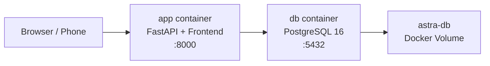

# ASTRA — Deployment Guide

## Deployment Modes

### 1. Local Development (Default)

The default mode — suitable for development, demonstrations, and NASA Space Apps presentations.

| Component | Configuration |
|---|---|
| Database | SQLite (`backend/data/astra.db`) — zero setup |
| Server | Uvicorn on `0.0.0.0:8000` |
| Frontend | Pre-built static bundle served by FastAPI from `frontend/dist/` |
| AI | Local deterministic engine (no network required) |

```powershell
powershell -ExecutionPolicy Bypass -File scripts\start.ps1
```

### 2. Docker Compose (Production-like)

Uses PostgreSQL 16, suitable for persistent deployments and team evaluations.



**Architecture:**
- **`db` service**: PostgreSQL 16 Alpine with health check, persistent named volume `astra-db`.
- **`app` service**: Multi-stage Dockerfile builds frontend and installs backend, depends on `db` health.
- **Networking**: The `app` container connects to `db` via the Docker internal network (`db:5432`).

**Required `.env` variables for Docker:**

| Variable | Example |
|---|---|
| `POSTGRES_PASSWORD` | `my-strong-password-here` |
| `ASTRA_SECRET_KEY` | *(generate with `python -c "import secrets; print(secrets.token_urlsafe(48))"`)* |
| `ASTRA_PUBLIC_BASE_URL` | `http://192.168.1.20:8000` |

---

## Network Configuration

### Same-Network Access (LAN Demos)

For presentations where examiners scan QR codes from their phones on the same Wi-Fi:

1. Ensure the server binds to `0.0.0.0` (default in `scripts/start.ps1`).
2. Find your LAN IP: `ipconfig` (Windows) or `ip a` (Linux/macOS).
3. Set `ASTRA_PUBLIC_BASE_URL=http://YOUR_LAN_IP:8000` in `.env`.
4. Allow Python through the firewall when prompted (private networks only).

### Remote Access (Internet Tunneling)

For evaluators on a different network:

**ngrok (Recommended):**
```bash
ngrok http 8000
# Copy the HTTPS URL → set ASTRA_PUBLIC_BASE_URL in .env
```

**LocalTunnel (No account needed):**
```bash
npx localtunnel --port 8000
```

---

## CORS Configuration

| Scenario | `ASTRA_CORS_ORIGINS` |
|---|---|
| Production (frontend served by FastAPI) | Not needed — same-origin |
| Development (Vite dev server on :5173) | `http://localhost:5173,http://127.0.0.1:5173` (default) |
| ngrok / tunnel | Add the tunnel URL to the comma-separated list |

---

## Health Checks

| Endpoint | Method | Expected |
|---|---|---|
| `GET /api/health` | HTTP | `200 OK` with JSON status |
| `GET /api/docs` | HTTP | OpenAPI Swagger UI |
| `GET /` | HTTP | Frontend SPA (index.html) |

For Docker, the PostgreSQL container includes a built-in health check:
```yaml
healthcheck:
  test: ["CMD-SHELL", "pg_isready -U astra -d astra"]
  interval: 5s
  timeout: 3s
  retries: 20
```

---

## QR Code Setup for Mobile Devices

ASTRA generates QR codes for two purposes:

1. **Viewer QR**: Read-only live telemetry stream for observers.
2. **Doctor/Examiner QR**: Interactive scenario injection console.

**Requirements:**
- Server and phone must be on the **same network**.
- `ASTRA_PUBLIC_BASE_URL` must be set to the server's **LAN-accessible** address.
- If running in Docker, this must be the **host machine's** LAN IP (the container cannot discover it).

---

## Security Considerations for Deployment

> [!WARNING]
> ASTRA is a prototype demonstration platform. The following considerations apply to any non-local deployment:

- **HTTPS**: Use a reverse proxy (nginx, Caddy) or tunnel (ngrok) for HTTPS in production.
- **Secret Key**: Always set `ASTRA_SECRET_KEY` explicitly in production. Never use the auto-generated file in shared environments.
- **Demo Passwords**: Set `ASTRA_DEMO_PASSWORD` to a strong value, or disable demo seeding with `ASTRA_SEED_DEMO_DATA=false` and create accounts manually.
- **API Keys**: Never commit `.env` files containing real API keys. The `.gitignore` excludes `.env` files (except `.env.example`).
- **Database**: For persistent data, use PostgreSQL via Docker Compose rather than SQLite.
