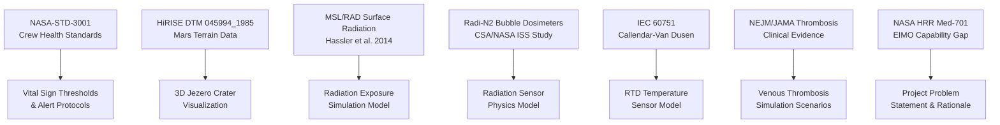

# ASTRA — NASA Data & Scientific References

> [!IMPORTANT]
> ASTRA is a **prototype demonstration platform**. All physiological data in the system is **synthetic/simulated** and generated for engineering validation. No real patient or astronaut data is used at runtime. The NASA references listed below inform the system's design, models, and validation scenarios — they are **not** live data feeds.

## NASA & Scientific Reference Inventory

### Primary NASA Resources

| ID | Title | Source | URL / DOI | Usage in ASTRA |
|---|---|---|---|---|
| res_1 | **Spaceflight Standard Measures (SSM)** | NASA HRP / LSDA | [lsda.jsc.nasa.gov](https://lsda.jsc.nasa.gov) — Hardy et al., npj Microgravity (2025) 11:78 | Informed the structure of the 18-feature physiological telemetry vector and normal/abnormal range definitions. |
| res_2 | **NASA Human Research Roadmap — Gap Medical-701 & Med10** | NASA HRP | [humanresearchroadmap.nasa.gov](https://humanresearchroadmap.nasa.gov/Gaps/gap.aspx?i=716) | Defines the Earth-Independent Medical Operations (EIMO) gap that ASTRA directly addresses. Core challenge justification. |
| res_3 | **NASA Open Science Data Repository (OSDR / GeneLab)** | NASA Ames | [osdr.nasa.gov](https://osdr.nasa.gov) | Referenced for spaceflight biological datasets; not directly consumed by the application. |
| res_4 | **NASA-STD-3001 Volumes 1 & 2** | NASA Technical Standards | [standards.nasa.gov](https://standards.nasa.gov/node/237) | Vol 1 Rev C (Crew Health) and Vol 2 Rev F (July 2026) — informed vital sign thresholds, alert protocols, and EVA countermeasure procedures. |
| res_5 | **In-Flight Venous Thromboembolism Investigations** | NEJM & JAMA Network Open | Auñón-Chancellor et al., NEJM (2020) 382:89-90; Marshall-Goebel et al., JAMA (2019) | Clinical evidence for IJV thrombosis simulation scenarios (Scenarios #16, #17). |
| res_6 | **Mars Science Laboratory RAD Surface Radiation** | NASA PDS | Hassler et al., Science (2014) 343(6169):1244791 | Calibrates the radiation exposure model (0.64–0.67 mSv/day surface dose rate). |
| res_7 | **NASA HiRISE Stereo DTM (045994_1985)** | NASA / USGS / U. Arizona | [uahirise.org](https://www.uahirise.org/dtm/dtm.php?ID=ESP_045994_1985) | 1 m/px elevation data for the Jezero Crater 3D Mars terrain visualization at the Perseverance landing site. |
| res_8 | **Radi-N2 Neutron Field Study (ISS)** | CSA & NASA | [asc-csa.gc.ca](https://www.asc-csa.gc.ca/eng/iss/radi-n2.asp) | Bubble dosimeter physics model for the radiation sensor implementation. |

### Additional Scientific Standards Referenced

| Standard | Purpose in ASTRA |
|---|---|
| **EVA-EXP-0034** (Exploration EVA Avionics) | Guided the sensor data interface specifications |
| **IEC 60751** (Callendar–Van Dusen Platinum RTD) | Temperature sensor physics model (Pt100/Pt1000 RTD) |
| **Beer–Lambert Law** | Pulse oximetry (PPG/SpO2) optical absorption model |

---

## Synthetic Data Disclosure

> [!CAUTION]
> The following datasets are **NOT** sourced from real NASA telemetry archives. They are synthetically generated to demonstrate the system's capabilities.

| Dataset | Location | Records | Description |
|---|---|---|---|
| `nasa_eva_medical_telemetry.csv` | `backend/data/` | 10,000 | Synthetically generated EVA telemetry records for ML model training. Distributions are calibrated against published NASA physiological ranges but the data is **not real**. |
| Simulation scenario vitals | Runtime-generated | N/A | Real-time telemetry values displayed during the 20 TDL simulation scenarios are computed by deterministic mathematical models, not recorded from actual astronauts. |

---

## Team Research Documents

The `docs/references/team_research/` directory contains research documents produced by team members during the project, including:

- Thin-Film Solar Helmet Feasibility Studies
- Biomedical Survival Sensors Reference
- Physical Instrument Reliability Reports
- NASA Helmet Feasibility Reports & Presentations
- Radi-N2 Study Analysis
- Sensor Physics & Vital Signs Problems Documentation
- Cold-Resistant Solar Panel Design

These documents represent **team-authored research** and are included to demonstrate the engineering analysis behind the sensor models.

---

## How References Are Used

