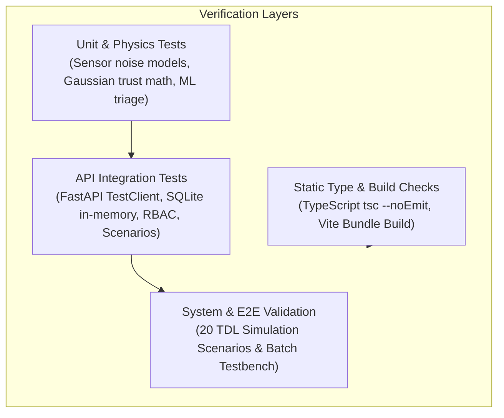

# ASTRA — Comprehensive Automated Test Plan

## 1. Objectives & Scope

The ASTRA Automated Test Suite is engineered to validate:
1. **Mathematical Soundness of the Trusted Data Layer (TDL)**: Proving that physical sensor faults, drift, and motion artifacts are deterministically suppressed while genuine physiological emergencies trigger life-support countermeasures.
2. **Clinical Decision Support & Machine Learning Reliability**: Validating the 18-feature Random Forest triage model against known NASA EVA historical anomalies.
3. **Role-Based Access Control (RBAC) & Security**: Enforcing strict permission isolation across the 5 authenticated user roles (`admin`, `physical`, `medical`, `operator`, `viewer`).
4. **Mission State Transitions & Emergency Operations**: Confirming that life-support state machines respond safely to acute hypothermia, hypercapnia, radiation events, and emergency stops.
5. **Fullstack API Contract Adherence**: Validating all REST and WebSocket contracts against strict Pydantic schemas.

---

## 2. Testing Pyramid & Tools



| Tool | Version | Target | Scope |
|---|---|---|---|
| **pytest** | `8.x` | Backend Python (`backend/tests`) | Unit, TDL physics, ML triage, API integration, RBAC |
| **httpx / FastAPI TestClient** | `0.27+` | Backend Endpoints | HTTP route compliance, header auth, error responses |
| **tsc (TypeScript Compiler)** | `5.2+` | Frontend (`frontend/src`) | Strict type checking, interface contracts, zero `any` leaks |
| **Vite** | `5.1+` | Frontend Bundling | Production tree-shaking, CSS bundling, asset hashing |

---

## 3. Test Categories & Directories

### 3.1 Backend Tests (`backend/tests/`)

1. **`test_trust_layer.py`**:
   - Mathematical bounds of Gaussian trust calculation ($T \in [0, 1]$).
   - Motion artifact suppression on SpO2 sensor (residual > 30% yields trust < 0.3).
   - Sensor drift detection via temporal derivatives.
   - Dual-sensor physiological cross-correlation (SpO2 drop without HR elevation is flagged as probe disconnect).

2. **`test_simulation_scenarios.py`**:
   - Verification of the 20 NASA Mars simulation use cases.
   - Correct diagnosis classification for Apollo 15 cardiac arrhythmia, ISS EVA 23 water intrusion, and solar radiation storms.
   - Autonomous emergency action verification (oxygen flush, LCVG cooling, shelter ingress).

3. **`test_api_auth_rbac.py`**:
   - JWT token generation, signature validation, and expiration.
   - Role enforcement matrix:
     - `viewer` restricted to GET-only telemetry.
     - `operator` permitted to trigger and abort simulation sessions.
     - `medical` permitted to override clinical rules and run ML triage.
     - `physical` permitted to modify sensor noise profiles.
     - `admin` permitted to execute user mutations and global system resets.
   - Unauthorized access returns HTTP `401 Unauthorized` or `403 Forbidden`.

4. **`test_medical_endpoints.py`**:
   - Verification of NASA clinical instruments endpoint (`/api/medical/instruments`).
   - Pre-simulation predictive risk scoring engine (`/api/medical/pre-sim-risk`).
   - 18-feature Random Forest ML triage inference (`/api/medical/ml-triage`).
   - ML model metadata and feature importance inspection (`/api/medical/ml-model`).

5. **`test_sensor_lab.py`**:
   - Spacesuit sensor placements, transducer parameters, and noise injection endpoints.

---

## 4. Test Data Management Strategy

- **Zero Network Flakiness**: All test suites run 100% offline. No live internet connection, cloud LLM, or external database is required.
- **In-Memory & Ephemeral Storage**: Tests execute against an isolated in-memory or ephemeral SQLite instance, torn down immediately upon test completion.
- **Deterministic Pseudo-Random Seeds**: Physics noise models and synthetic test vectors utilize deterministic seeds to guarantee reproducible pass/fail behavior across differing operating systems.

---

## 5. Execution Commands

```powershell
# Run full backend test suite with verbose output
.\backend\.venv\Scripts\pytest.exe -v backend/tests

# Run specific category (e.g., medical ML & instruments)
.\backend\.venv\Scripts\pytest.exe -v backend/tests/test_medical_endpoints.py

# Frontend TypeScript static verification
cd frontend; npm run typecheck

# Frontend production bundle compilation
cd frontend; npm run build
```
