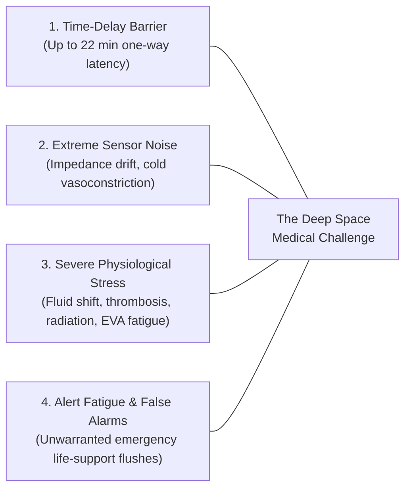

# NASA Space Apps Challenge 2026 — Problem Statement & Solution

## 1. The Deep-Space Healthcare Crisis

Human exploration of Mars represents the most challenging expeditionary endeavor in human history. Unlike missions in Low Earth Orbit (LEO) aboard the International Space Station—where emergency deorbit and return to a terrestrial tertiary hospital can occur within hours—a Mars transit crew is isolated by astronomical distances.

### The Problem in 4 Dimensions:

1. **The Communication Latency Barrier**:
   Radio signals traveling between Earth and Mars require between 3 and 22 minutes each way (6 to 44 minutes round-trip). During acute physiological emergencies (e.g., ventricular arrhythmia, suit decompression, acute solar particle exposure, or hypercapnia), real-time interactive medical guidance from Flight Surgeons in Houston is physically impossible.

2. **Sensor Vulnerability in Deep Space**:
   Wearable physiological sensors operate in hostile conditions. Severe cold during Martian surface EVAs induces peripheral vasoconstriction, attenuating optical pulse oximeter signals. Astronaut physical exertion, sweat accumulation, and microgravity fluid shifts cause electrode peeling and triboelectric noise on ECG leads, mimicking deadly arrhythmias.

3. **Physiological Vulnerability**:
   Extended microgravity induces cephalad venous fluid shifts (1.5–2.0 L towards the head), leading to internal jugular vein distension, blood stasis, and occlusive venous thrombosis (documented aboard ISS). Ambient spacecraft CO2 levels (2.0–4.0 mmHg vs 0.3 mmHg on Earth) cause chronic hypercapnia and headaches.

4. **The False Alarm Dilemma**:
   When automated systems cannot verify sensor data reliability, they face a dangerous trade-off: trigger premature, unneeded emergency responses (depleting limited consumables like oxygen) or ignore subtle precursor symptoms of genuine medical collapse.

---

## 2. The ASTRA Solution

ASTRA solves this systemic challenge with an integrated, earth-independent computational architecture:

| Challenge | Traditional Approach | The ASTRA Innovation |
|---|---|---|
| **Comms Latency** | Terrestrial telemedicine via Mission Control | **Local-First Autonomous Intelligence**: 100% offline deterministic clinical engine + ML triage running directly on edge avionics. |
| **Sensor False Alarms** | Static threshold alerts (alarm on SpO2 < 90%) | **Deterministic Trusted Data Layer (TDL)**: Fuses Gaussian likelihood, temporal derivatives, and cross-sensor physiological plausibility to down-weight and suppress sensor motion artifacts. |
| **Multi-System Complexity** | Isolated single-sensor gauges | **18-Dimensional Holistic ML Model**: Evaluates vital signs, environmental life support, and cognitive fatigue simultaneously with 95.15% accuracy. |
| **Situational Awareness** | Abstract 2D numbers and logs | **Authentic 3D Mars HiRISE Environment**: Real Jezero Crater topography tracking terrain slopes, rover assets, and radiation exposures. |
| **Training & Drills** | Static scripted training manuals | **Mobile QR Scenario Injection**: Examiners inject natural-language medical emergencies in real-time on tablet/phone without setup friction. |

---

## 3. Impact & Mission Relevance

By enabling Earth-Independent Medical Operations (EIMO), ASTRA directly supports NASA Human Research Roadmap goals (Gaps Medical-701 and Med10). The platform protects astronaut life, prevents unnecessary mission aborts, conserves critical life-support consumables, and provides crew members with confidence that their health telemetry is thoroughly validated before actions are taken.
