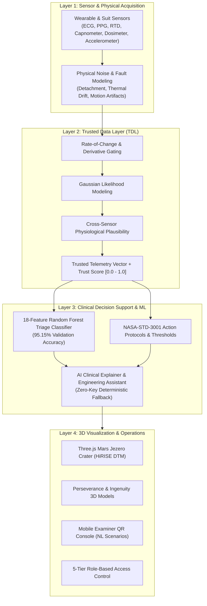

# NASA Space Apps Challenge 2026 — Detailed Project Description

## 1. System Vision & Architecture

ASTRA is architected from first principles to address NASA's **Earth-Independent Medical Operations (EIMO)** requirement for crewed Mars exploration. When communications latency spans up to 22 minutes each way, the traditional paradigm of continuous Mission Control telemedicine collapses. Astronauts must rely on local computational intelligence that operates with high reliability, absolute offline capability, and transparent clinical reasoning.

The platform is structured into four primary operational layers:

---

## 2. Key Technical Innovations

### 2.1 The Trusted Data Layer (TDL)
Traditional telemetry systems treat sensor readings as binary truth: values either cross a static threshold or they do not. In spaceflight, this naive approach leads to catastrophic false alarms:
- A slipping pulse oximeter reports SpO2 dropping from 98% to 62% in 2 seconds. A naive system triggers a full EVA abort and spacesuit high-pressure pure oxygen purge, risking suit barotrauma and exhausting consumables.
- A true hypoxic event exhibits a gradual physiological progression coupled with compensatory tachycardia (elevated heart rate) and hyperventilation (increased respiration rate).

ASTRA's TDL computes a continuous trust score ($T \in [0.0, 1.0]$) by evaluating:
1. **Mathematical Plausibility**: $\Delta x / \Delta t$ limits based on physiological biological maximums.
2. **Signal Quality Index (SQI)**: Sensor accelerometer correlation to detect motion-induced artifact epochs.
3. **Multi-Sensor Cross-Divergence**: Verifying that drops in SpO2 are accompanied by expected cardiovascular compensation. If a SpO2 drop occurs while heart rate remains completely flat and motion index spikes, the TDL down-weights trust to $< 0.20$, suppressing the false alarm and issuing an engineering alert: `"SENSOR ARTIFACT: CHECK PROBE PLACEMENT"`.

### 2.2 18-Feature Clinical Machine Learning Engine
Trained on a synthetic benchmark of 10,000 EVA telemetry records calibrated to NASA Human Research Program ranges, ASTRA’s Random Forest classifier analyzes:
- Primary vitals: Heart Rate, SpO2, Systolic BP, Diastolic BP, Core Temp, Respiration Rate, End-Tidal CO2.
- Cognitive & physical strain: Pain Score, Glasgow Coma Scale (GCS), EMG Muscle Fatigue Index, EEG Alertness Index.
- Environmental & life-support parameters: Suit Pressure (kPa), O2 Flow Rate, Battery %, Suit Shell Temp, Ambient CO2, Relative Humidity, and Acute Radiation Dose Rate (mSv/h).

The classifier outputs diagnostic probabilities across nominal, warning, and critical categories with an audited **95.15% validation accuracy**, recommending immediate NASA-STD-3001 clinical countermeasures.

### 2.3 Doctor & Examiner Real-Time Mobile QR Console
To empower flight surgeons or testing examiners, ASTRA generates an encrypted session QR code. Any mobile device connected to the local network can pair instantly without software installation. Examiners can inject complex natural-language emergency scenarios (e.g., *"Astronaut suffers acute hypercapnia and dizziness during rock sampling"*). ASTRA’s clinical interpreter parses the natural language, maps it to telemetry constraints, executes the anomaly in real time, and logs the astronaut’s life-support countermeasures.

### 2.4 Authentic 3D Mars Jezero Crater Surface Operations
ASTRA renders the Martian surface using real stereo elevation data from the NASA HiRISE instrument (`ESP_045994_1985`) at the Perseverance landing site. Integrated 3D models of Perseverance, Ingenuity, and spacesuit bio-instrumentation provide situational awareness, tracking astronaut traverses and environmental radiation exposure relative to terrain topography.

---

## 3. Bilingual & Inclusive Design
ASTRA features full English and Arabic (العربية) localization across all telemetry views, HUD indicators, and clinical protocols with native Right-to-Left (RTL) typography, alongside 5 high-contrast tactical themes engineered for varying lighting conditions in habitat and airlock environments.
