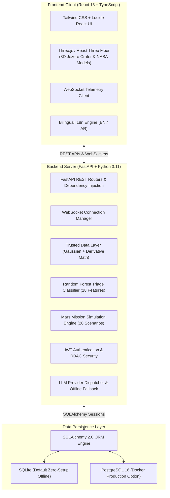

# NASA Space Apps Challenge 2026 — Technical Architecture

## 1. System Topology & Technology Stack

ASTRA is engineered as a modern, decoupled client-server application built with Python and React:



### Technology Matrix:
- **Backend**: Python 3.11.9, FastAPI 0.115+, Uvicorn 0.30+, SQLAlchemy 2.0+, Pydantic v2, PyJWT 2.8+, Psycopg 3.
- **Frontend**: React 18.3, TypeScript 5.2, Three.js 0.160, React Three Fiber, Tailwind CSS 3.4, Vite 5.1.
- **Data Persistence**: SQLite (local single-file zero-configuration at `backend/data/astra.db`), PostgreSQL 16 (containerized via Docker Compose).
- **Communication Protocols**: Asynchronous HTTP REST endpoints and low-latency full-duplex WebSockets for real-time telemetry broadcast.

---

## 2. Trusted Data Layer (TDL) Mathematical Formulation

The Trusted Data Layer rejects sensor artifacts through multi-stage mathematical evaluation:

### Stage 1: Rate-of-Change Derivative Gating
For any physiological metric $x_i(t)$, the temporal derivative is evaluated against biological maximum velocity $V_{\max}$:
$$\left| \frac{\Delta x_i}{\Delta t} \right| = \left| \frac{x_i(t) - x_i(t - \Delta t)}{\Delta t} \right| > V_{\max} \implies \text{Flag Artifact}$$

### Stage 2: Gaussian Likelihood Scoring
The likelihood of an observed value $x$ given historical moving window baseline $\mu$ and standard deviation $\sigma$:
$$L(x | \mu, \sigma) = \exp\left( - \frac{(x - \mu)^2}{2\sigma^2} \right)$$

### Stage 3: Multi-Sensor Cross-Divergence
Cross-sensor physiological plausibility requires that an acute drop in peripheral oxygenation ($\Delta \text{SpO}_2 < -10\%$) must be accompanied by compensatory autonomic cardiac activation ($\Delta \text{HR} > +15 \text{ bpm}$) and tachypnea ($\Delta \text{RR} > +4 \text{ br/min}$):
$$\text{If } \Delta \text{SpO}_2 < -10\% \text{ and } \Delta \text{HR} \approx 0 \implies \text{Trust Score } T \leftarrow T \times 0.20 \quad (\text{Probe Displacement})$$

---

## 3. Data Dictionary & Key Schemas

### 18-Feature Physiological Telemetry Vector
```json
{
  "heart_rate": 78.5,
  "spo2_pct": 98.2,
  "systolic_bp": 118.0,
  "diastolic_bp": 76.0,
  "temperature_c": 36.8,
  "respiration_rate": 14.0,
  "etco2_mmhg": 38.0,
  "pain_score": 0.0,
  "gcs_total": 15.0,
  "radiation_msv_h": 0.02,
  "suit_pressure_kpa": 29.6,
  "o2_flow_lpm": 5.2,
  "battery_pct": 88.5,
  "suit_temp_c": 19.5,
  "co2_ppm": 420.0,
  "humidity_pct": 45.0,
  "emg_fatigue_index": 0.12,
  "eeg_alertness_index": 0.88
}
```

---

## 4. Containerization & Production Deployment

ASTRA supports instant single-command containerization via Docker Compose:
- **`app` container**: Multi-stage Docker build packaging the Python FastAPI backend and pre-compiled React static assets.
- **`db` container**: Hardened PostgreSQL 16 Alpine database with health checks and persistent storage volumes.
- Zero external cloud services required to deploy and run.
